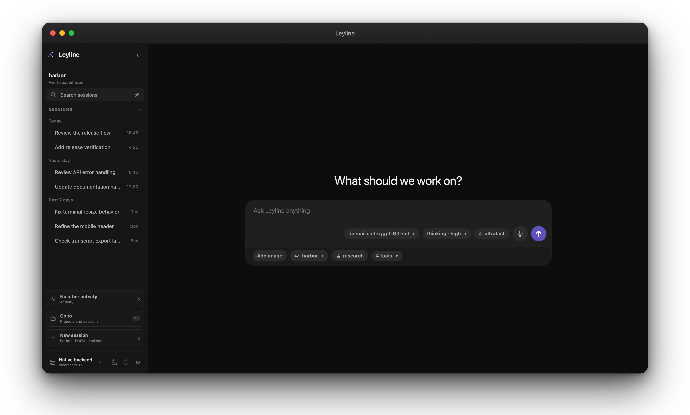
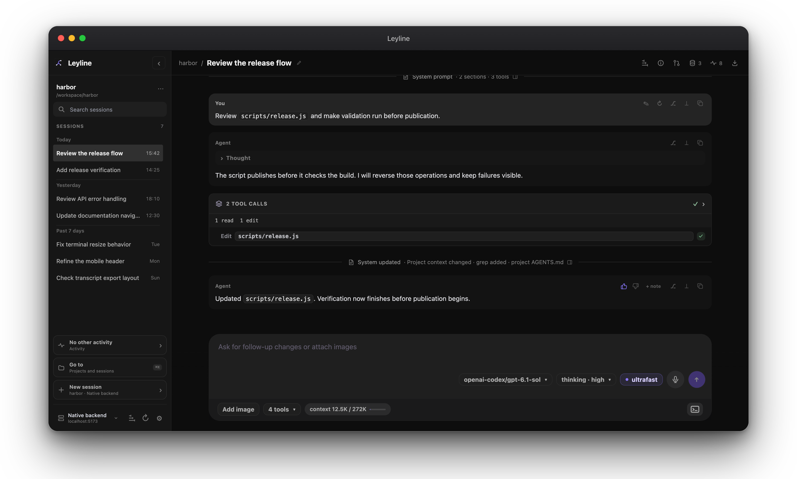
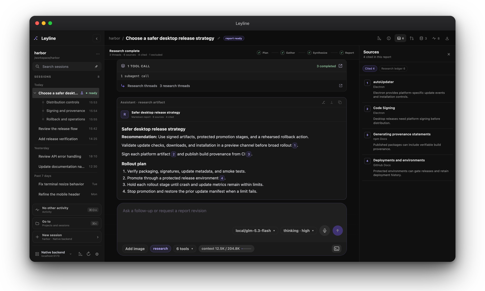
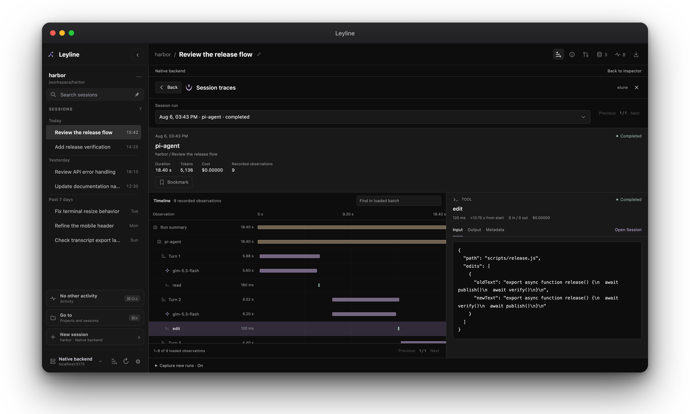

#  Leyline

Leyline is a web UI for pi coding-agent sessions. It uses Vue 3 and Vite for
the frontend. Its native backend uses the pi SDK for sessions, prompts, model
controls, runtime events, and the embedded terminal. You can also save named
connections to other Leyline backends.

## Screenshots

<table>
  <tr>
    <td width="50%"><a href="assets/readme/home.png"></a><br /><strong>Start screen</strong></td>
    <td width="50%"><a href="assets/readme/workbench.png"></a><br /><strong>Workbench</strong></td>
  </tr>
  <tr>
    <td><a href="assets/readme/deep-research.png"></a><br /><strong>Deep research</strong></td>
    <td><a href="assets/readme/tracing.png"></a><br /><strong>Tracing workspace</strong></td>
  </tr>
</table>

See [Tracing](docs/user-guide/tracing.md) for recorded runs and capture controls.

## Documentation

- [Getting started](docs/getting-started/index.md)
- [Linux installation](docs/getting-started/linux-installation.md)
- [Sessions](docs/user-guide/sessions.md)
- [Composer](docs/user-guide/composer.md)
- [Deep research](docs/user-guide/deep-research.md)
- [Git review](docs/user-guide/git-review.md)
- [Images and vision](docs/user-guide/images-and-previews.md)
- [Memory](docs/user-guide/memory.md)
- [Subagents](docs/user-guide/subagents.md)
- [Settings, providers, and MCP](docs/user-guide/settings.md)
- [Tracing](docs/user-guide/tracing.md)
- [Elune integration](docs/integrations/elune.md)
- [Runtime events](docs/user-guide/runtime-events.md)
- [Terminal](docs/user-guide/terminal.md)
- [Electron](docs/electron/index.md)
- [Commands](docs/reference/commands.md)
- [Troubleshooting](docs/reference/troubleshooting.md)

## Features

- Browse, search, pin, and run pi sessions across projects. Read live
  transcripts and monitor work in **Activity**.
- Steer active work or queue **Up next** tasks. Examine tools, System
  changes, local files, and Git changes. Use configured MCP tools and
  respond to extension requests in the workspace.
- Use memory, subagents, HTML export, an embedded terminal, and deep
  research with validated citations. A configured vision model can
  describe images for models that cannot receive images.
- Connect each window to the native backend or a saved backend
  connection. Configure provider sign-in, custom endpoints, model
  overrides, and MCP servers in [Model settings](docs/user-guide/settings.md#find-a-configuration-in-the-catalog).
- Embedded Elune tracing records new runs by default. Examine one
  session or traces across projects on the selected backend. Traces can
  contain private prompts and tool results. See
  [Tracing](docs/user-guide/tracing.md).

Read [Motivations](docs/motivations.md) for the project direction.

## Requirements

- macOS or Linux (see the tested setup below)
- Node.js 22.19.0, as specified in `.nvmrc`
- npm and Git, with GitHub access during dependency installation
- A configured pi coding-agent environment

Leyline operates on macOS and Linux. The Linux reference setup is x86-64
Omarchy (Arch-based). The setup runs Hyprland on Wayland. Leyline did not
validate other Linux distributions or architectures. Do not use Leyline on
Windows.

For a Linux desktop app and CLI that installs for one user, follow the
[Linux installation guide](docs/getting-started/linux-installation.md).

## Setup

```sh
npm install
```

This installs `@elune/embedded` from GitHub through the `spmurrayzzz/elune`
dependency. A sibling Elune checkout, an npm publication, and a standalone Go
server are not necessary.

## Development

```sh
npm run dev
```

Open the Vite URL that the terminal shows. The usual URL is:

```txt
http://localhost:5173/
```

The Vite server also serves the documentation at
`http://localhost:5173/docs/`. To run only the documentation server, use
`npm run docs:dev`.

## Backend connections

The sidebar footer shows the backend for the current window. Open **Settings →
Connections**. You can add, test, edit, remove, or select a named connection
there. The **Native backend** is the server that supplied the current Leyline
app.

To share the native backend with other devices, enable **Allow network access**
in **Settings → Connections**. Copy a sharing URL and open it on the other
device. For a fixed port, set **Proxy port** and select **Apply**. Leave it blank
for automatic selection. Changes apply immediately. Local clients and agents
stay connected, but a port change or disabling sharing disconnects remote
clients. The API has no authentication, so use trusted networks only. See
[Network access](docs/user-guide/settings.md#share-the-native-backend).

Saved connections and the configured default are app-wide. Each browser or
Electron window keeps its active connection independently. A new window uses
the default. A new Electron window inherits the source window's active
connection.

Runtime HTTP commands, runtime and Git review events, terminal traffic, trace
requests, and exports use the active backend. Events and terminal traffic use
separate WebSockets. Leyline does not combine
traces or capture settings across connections. Traces and capture settings stay
on the active backend. Connection management stays on the native backend. See
[Settings](docs/user-guide/settings.md) for
connection setup and [Environment variables](docs/reference/environment.md) for
packaged server and origin settings.

The frontend and backend must both use API v2. Runtime and Git review events
require WebSockets, with no SSE fallback. See
[Realtime events](docs/developer-guide/realtime-events.md).

## Optional Electron app

The browser and Vite workflow is the primary development path. Leyline can also
run as a local Electron desktop app.

For Electron development, start Vite in one terminal:

```sh
npm run dev
```

Then launch Electron in another terminal:

```sh
npm run electron:dev
```

Run this command to build a packaged desktop app:

```sh
npm run electron:build
```

The build writes the packaged app to `release/`. The build creates the Vite
`dist/` output and then packages Electron. The build unpacks the native
terminal files that `node-pty` needs and the embedded Elune library and SQLite
worker. The packaged backend runs in an Electron utility process. Rebuild and
restart the packaged app after dependency or backend updates.

On Linux, follow the [Linux installation guide](docs/getting-started/linux-installation.md)
to install `release/Leyline-linux-x64/`, a launcher, and an application-menu entry.
The repository's `bin/leyline` and `local-publish` script are still macOS-only.

On Apple silicon macOS, run this command to install the packaged app and
expose `leyline`:

```sh
npm run local-publish
```

This command puts `Leyline.app` in `/Applications/`. The command also links the
CLI to `~/.local/bin/leyline`. Make sure that `~/.local/bin` is on your `PATH`.

```sh
cd /path/to/project
leyline
```

The CLI opens or focuses Leyline and creates a session for the current shell
directory. Use `leyline -n` to open a new window at the home workspace. The
command does not create a session.

## Electron shortcuts (macOS)

- `Command+N`: create a session in the current session CWD
- `Command+Shift+N`: open Home in a new window. This does not create a session
- `Command+W`: close the current window
- `Command+E`: show or hide the sidebar
- `Command+,`: open global Settings
- `Command+Shift+E`: show or hide Session details
- `Command+Shift+M`: show or hide Memory
- `Command+Shift+T`: show or hide the terminal
- `Escape`: close open surfaces first. If no surface is open, stop the active run

When focus is in the terminal, Escape stays in the shell unless another surface
is open.

## Useful commands

```sh
npm run build
npm run preview
npm run docs:dev
npm run docs:build
npm run docs:screenshots
npm run electron:dev
npm run electron:build
npm run local-publish # Apple silicon macOS only
npm run screenshot
npm run video
```

The capture commands require the Vite development server. `npm run screenshot` writes a
live local capture to `screenshots/current.png`. `npm run docs:screenshots`
refreshes sanitized tracked images with intercepted fixture data.
