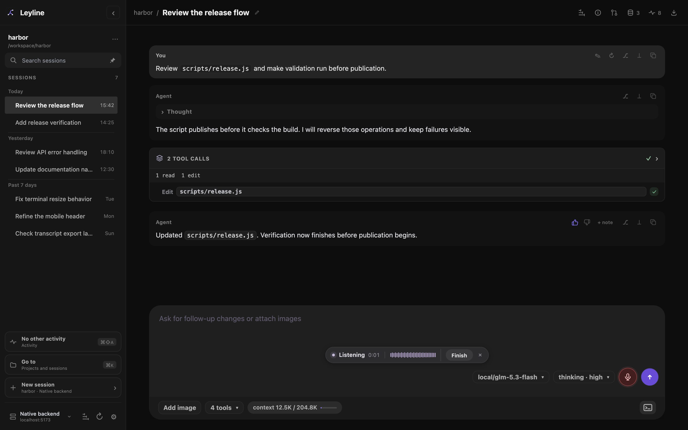
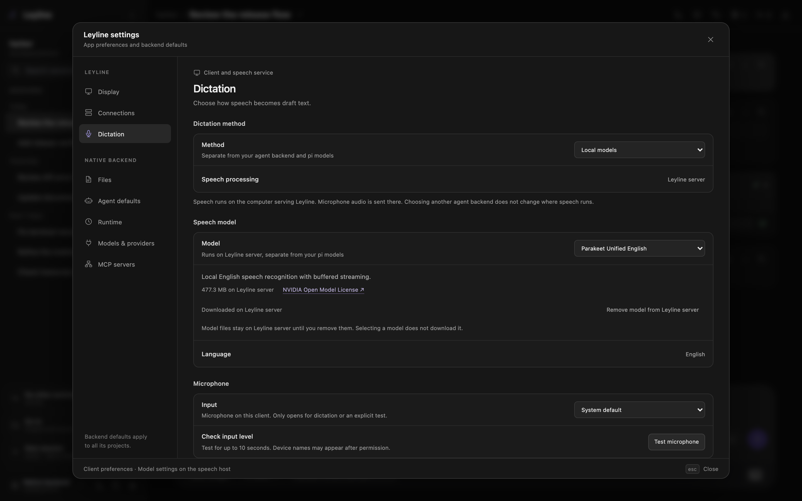
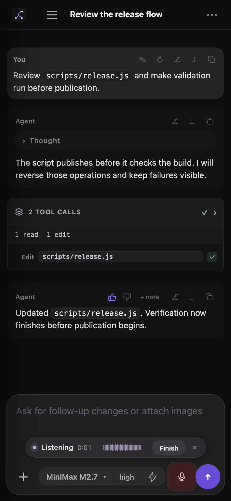

# Dictation

Dictation adds recognized speech to the composer draft. Recognition does not submit the draft. **Send**, **Enter**, and **Option+Enter** finish active dictation before the normal composer action.

*Local dictation in progress. The waveform responds to microphone audio and shows about one second of recent activity.*

## Choose a method

Open **Settings → Dictation** and select a method. Dictation settings are separate from the selected agent backend and pi models.

- **Browser dictation** uses the browser's Web Speech recognition. A browser may send audio to an online service. Processing is browser-managed and is not guaranteed to stay on this device. Browser availability and language support depend on the browser.
- **Local models** runs speech recognition on the computer that serves Leyline in a browser. Leyline sends microphone audio to that computer. In Electron, processing runs on this device. Local dictation does not switch to browser dictation if a model or service is unavailable.

Browser users start with Browser dictation. Electron users start with the local option. You can select another available method in Settings.

## Set up local dictation

In a browser, microphone access requires a secure context: open Leyline over HTTPS or at `localhost`. A LAN address served over ordinary HTTP cannot record audio, even when the local model is downloaded. Electron uses separate app and operating-system microphone permissions.

1. Open **Settings → Dictation**.
2. Set **Method** to **Local models**.
3. Select a speech model.
4. Select **Download** and wait for the download to finish.
5. If the selected model offers language choices, select a language.
6. Use **Test microphone** to check the input level, or start dictation from the composer.

Leyline supplies **Parakeet Unified English** and **Whisper Large v3 Turbo**. Parakeet transcribes while you speak and supports English. Whisper transcribes after you finish and supports English or language detection. Model downloads are separate from pi and agent model downloads.

Parakeet downloads from `leyline.download`, with Hugging Face as a fallback. Whisper downloads from Hugging Face. Leyline checks each file's size and SHA-256 checksum.

The download is stored on the speech-processing computer. By default, model files are under `$HOME/.local/share/leyline/dictation/models`. Set `LEYLINE_MEMORY_DIR` to use a different Leyline data directory. In browser use, this path is on the computer serving Leyline.

*Local model and microphone settings. A selected model must be downloaded before you can use it.*

## Record and insert speech

Select the composer microphone button, or use the in-app shortcut. The compact status capsule shows the recording state, elapsed time, and **Finish** and **Cancel** controls.

During local dictation, the waveform shows recent microphone audio. During Browser dictation, the waveform is a static motif because the browser does not provide an audio-level signal to Leyline. The microphone button tooltip and the **Speech processing** row in Dictation settings identify **Browser** or the local processing location.

Select **Finish** to stop and insert recognized text. Select **Cancel** to discard the recording. A microphone test uses **Stop test** instead. The microphone closes when dictation or a test ends. Keeping a local model ready does not keep the microphone open.

Leyline inserts text at the selection captured when recording starts. If you edit the draft during recording, finishing can detect that the draft changed. Leyline then leaves the draft unchanged and shows the recognized final text as a recoverable transcript that you can copy or dismiss.

Select **Send** or press **Enter** to finish recording and send or queue the draft. During a run, **Option+Enter** finishes recording and steers the agent. These keys also work from composer controls or the page body when the text area has no focus. They do not override unrelated fields, dialogs, terminal input, or a microphone test.

During recording, **Escape** does not stop dictation or the agent. After a dictation error, **Escape** dismisses the error before it can stop the agent.

Leyline cancels recording if the window loses focus, the tab becomes hidden, focus moves outside the composer, or you navigate away or change sessions. Cancellation does not guarantee a recoverable transcript. Select **Finish** before you leave the composer. There is no automatic send when speech recognition finishes.

*Dictation controls remain available in the narrow composer layout.*

> **iOS:** The composer microphone does not work over a local-network HTTP address on iPhone or iPad. Use HTTPS or the iOS keyboard's microphone instead.

## Microphone and language

Local dictation uses the selected input device, or the system default. The browser or operating system can ask for microphone permission. Grant permission to record. Use **Test microphone** in Settings to check input level; the test stops after 10 seconds unless you stop it first.

Browser dictation uses the browser's microphone and recognition language. Local language choices depend on the selected model. Parakeet supports English. Whisper supports English and automatic language detection.

## Shortcut and model memory

The default in-app shortcut is **Command+Shift+D** on macOS and **Ctrl+Shift+D** on other platforms. In **Settings → Dictation**, select the shortcut to change it. Choose **Press to toggle** or **Hold to speak**. Hold mode finishes when you release the shortcut.

The shortcut works only while Leyline is focused. It is not a global system shortcut. Shortcut and microphone preferences are stored for this client. Model and language settings apply to the speech service.

**Keep model ready** controls model memory on the speech-processing computer. When enabled, **Unload after idle** sets how long Leyline keeps the loaded model ready between recordings. Use whole minutes from 0 through 60. Set **0** to disable idle unloading. This does not keep the microphone open. Disabling **Keep model ready** unloads the model after use; downloaded model files remain on disk.

Dictation does not provide cloud speech providers, named profiles, or cleanup models.
