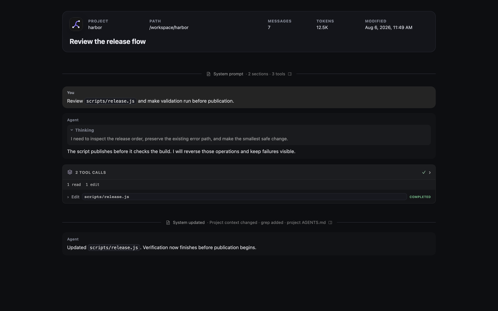
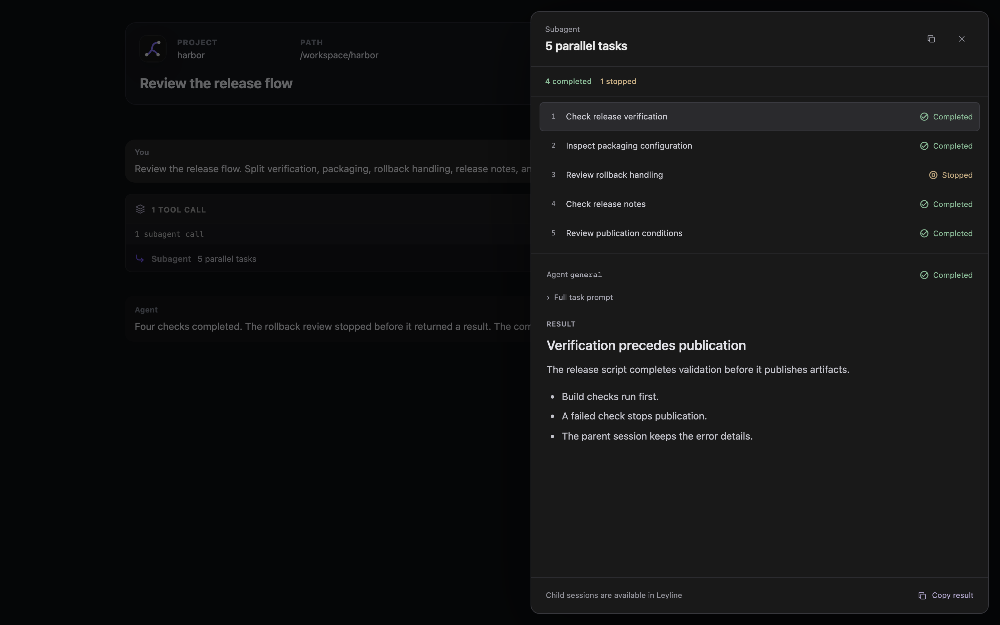

# Export a transcript

Use **Export transcript** to download the selected session as an HTML file.

*The export places session metadata above a standalone transcript view.*

## Download the export

1. Open a non-empty session.
2. Select **Export transcript** in the workbench header.
3. Open the downloaded `.html` file.

The file name starts with `leyline-` and uses the session title when possible.

## Read export metadata

The export header contains:

- Session title.
- Project name.
- Project path.
- Message count.
- Context token count.
- Modified time.

The token value is the latest available context usage. It is not a total of all tokens used across the session.

## Read export content

The export includes rendered Markdown, assistant thoughts, Activity cards, skills, subagent results, and attached images. Skills retain the app's prompt headers, expandable read rows, and status labels.

System events use the same muted dividers as the app. Select **System prompt** or **System updated** to open the prompt inspector.

The **Prompt** tab shows initial prompt sections. Later events use **Changes** for updated or removed sections. These changes do not reconstruct the full prompt. **Tools** shows initial or added tool descriptions and removed tool names.

**Raw text** shows the exact event text. **Copy** copies that same text from either view. **Reading view** returns to the tabs. Select **Close prompt inspector** or press Escape to close the inspector. Exports do not include **Fork from here** or **Reset to here**.

The inspector controls and instruction-file diffs are included in the exported HTML. They do not require network access. Modified and removed instruction files show added and removed lines. Added files show full content. If a recorded comparison is unavailable, the inspector explains why it shows full content instead.

A deep research export also includes the styled report, research-thread results, and every ledger source. Each source shows one evidence summary. An excluded source shows its exclusion reason instead.

Tool rows render their previews when you expand them. Exported runtime event rows are omitted.

Elune traces are separate from the transcript and are not included in the HTML. Leyline currently has no trace export control or API. See [Tracing](./tracing).

Images and transcript data are embedded in the HTML. File, diff, and patch previews in tool rows load their renderer from `esm.sh` when expanded. Those tool previews require network access.

## Inspect exported subagents

Subagent calls stay compact inside Activity. A card containing only one subagent call opens its inspector directly from the header or row, including calls with parallel tasks. Expand cards with several tool calls first.

Select a task to read its Markdown result and **Full task prompt**. Missing outcomes remain **Unknown**. When task results are unavailable, **Call output** retains the original response or error. The inspector and its copy controls work offline.

The exported inspector shows recorded task results. It does not subscribe to live child activity. Live previews and child-session navigation are available only in Leyline.

Press Escape, select the close button, or select the backdrop to return to the transcript.

## Use the responsive layout

The export changes to a compact layout below 820 pixels. Metadata uses two columns, and message padding decreases.

Above 1120 pixels, the System inspector reserves space beside the transcript. At narrower widths, it overlays the right side. At 760 pixels or less, it fills the viewport width.

The subagent inspector uses a floating side sheet on desktop and a bottom sheet at 760 pixels or less. It does not expand or shift the transcript.

The HTML also respects the system reduced-motion preference.

Research citations remain normal links in the standalone file. They do not focus a source-ledger card.

## Share an inline export

A server can open the export inline by using the inline disposition URL. When public sharing is configured, Leyline adds canonical, Open Graph, and Twitter metadata.

The share metadata contains the title, project name, message count, page URL, and a configured preview image. The normal header action downloads the file.
