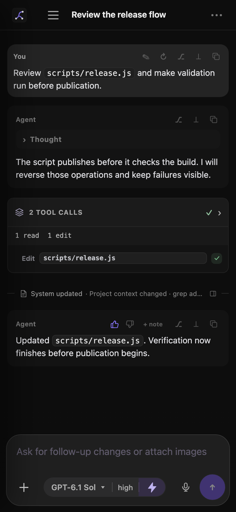
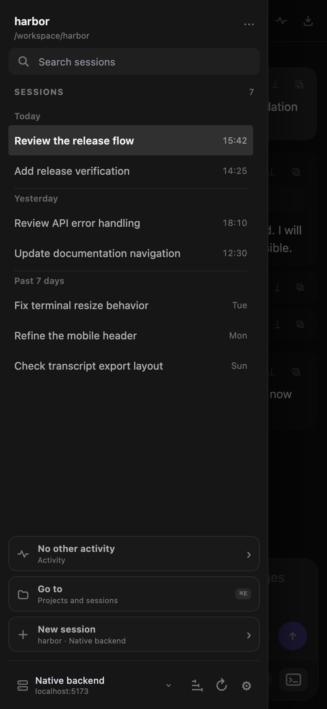
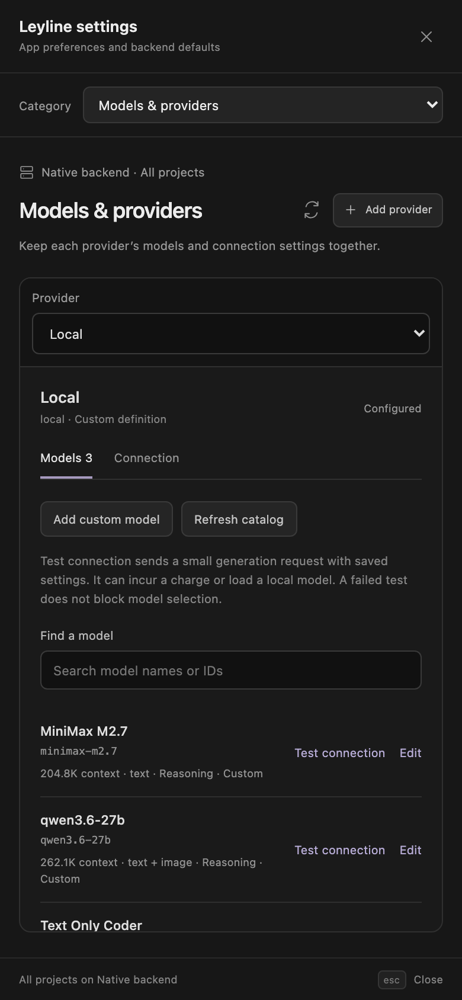
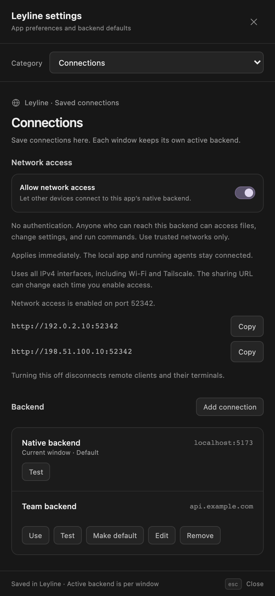
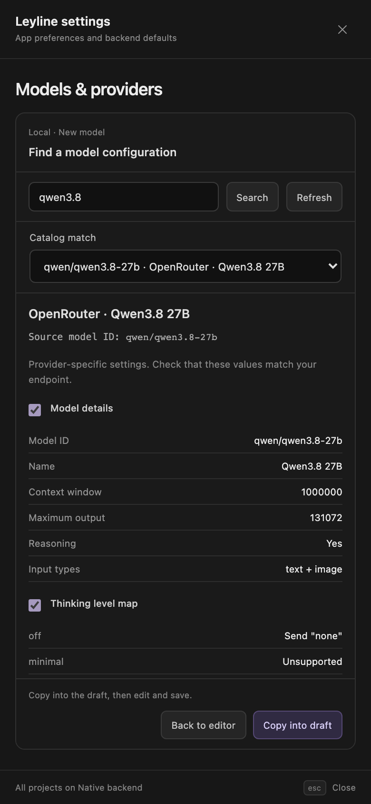
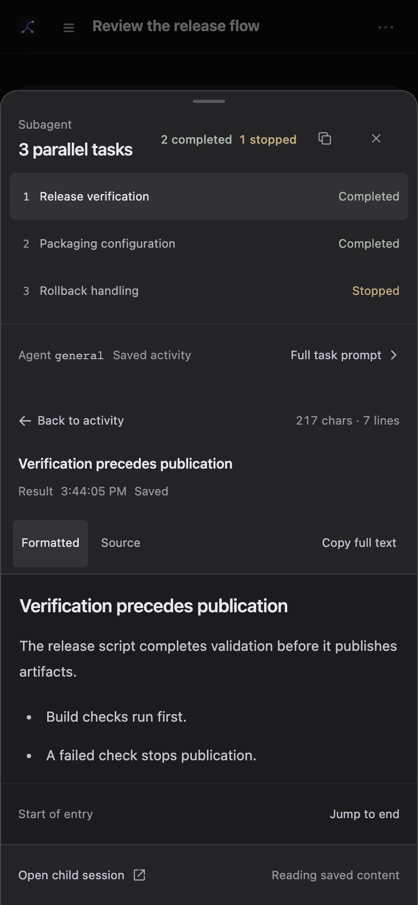
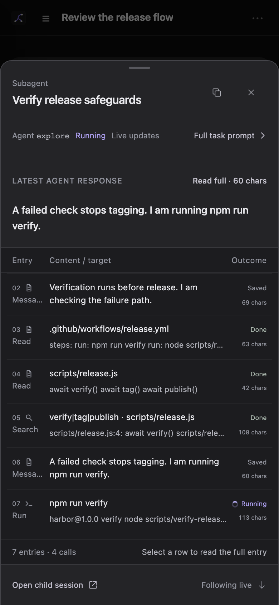
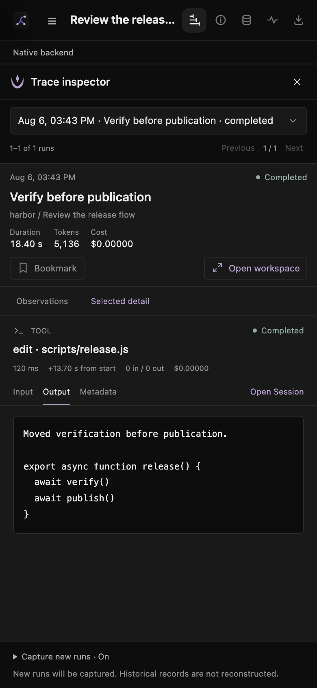

# Mobile layout

Leyline uses a mobile layout when the viewport is 760 pixels wide or less.

*The mobile workbench keeps the main session actions in one column.*

## Use the mobile header

The header shows the Leyline mark, **Open sessions**, the session title, and available transcript controls.

The project part of the breadcrumb is hidden. The session rename glyph is also hidden, but you can select the title to rename it.

The **Session traces**, **Session details**, **Memory**, **Events**, and **Export transcript** icons remain available when the session and backend support them. Numeric counts are hidden.

A research session also shows its compact state and source control. The source count is hidden, but the control remains available.

## Open the mobile sidebar

*The session navigator opens above the mobile workbench.*

1. Select **Open sessions** in the header.
2. Select a session in the current project.

Subagent children appear as nested rows under their parent. Use the parent's left chevron to show or hide them. Select a child row to open its transcript. See [Sessions](./sessions#open-a-subagent-session) for expansion and search behavior.

Select **Go to** to open a session from another project.

The sidebar opens over the workbench. Select the shaded area or a session to close it.

The sidebar can use up to 86 percent of the viewport width, with a maximum width of 320 pixels. **Activity**, **Go to**, and **Add project** use the full viewport. **Add project** keeps its confirmation actions at the bottom.

## Open Settings on mobile

1. Select **Open sessions**.
2. Select **Open settings** at the bottom of the sidebar.
3. Use **Category** to select the settings page.

Settings fills the mobile viewport. **Models & providers** and **MCP servers** use a **Provider** or **Server** selector instead of the desktop list. Detail content scrolls within the modal.

Use **Close Leyline settings** to return to the workspace. See [Settings](./settings) for scope, authentication, and reload behavior.

### Share the backend with another device

Select **Connections** in **Category**, then turn on **Allow network access**. Copy an address that the other device can reach.

For a fixed port, enter **Proxy port** and select **Apply**. Leave the field blank for automatic selection. The port stays saved across restarts, and **Apply** does not change the sharing switch.

Changing the active port or turning access off disconnects remote clients and their terminals. Local clients and running agents continue. Use trusted networks only because the API has no authentication. See [Network access](./settings#share-the-native-backend) for scope and connection details.

### Edit a model or copy catalog fields

The model editor temporarily hides the category and provider selectors. **Model**, **Thinking & compatibility**, and **Pricing** share one draft. Save/Test stay visible below the fields.

**Find in catalog** replaces the fields with search and review. Use **Catalog match** to choose a provider variant. Search and the Back/Copy controls stay visible while the review scrolls.

Copying **Model details** opens **Model**, where you can edit a new model's imported ID. **Back to editor** keeps your draft. See [Catalog lookup](./settings#find-a-configuration-in-the-catalog) for copied fields and exclusions.

## Supervise activity on mobile

*Activity keeps long session details bounded and moves row controls below the status on narrow screens.*

1. Select **Open sessions**.
2. Select **Activity**.
3. Select **Open** or **Stop** for a session.

The mobile view uses the same attention, running, queued, held, and shared-working-tree states as the desktop view. Open a session to resume its held queue or reply to a confirmation.

## Use transcript actions

Message and tool actions remain in their row headers. Use them to copy, edit, retry, fork, reset, or open tool output.

Tool targets can shorten to fit the row. User messages and tool cards use the full transcript width.

## Inspect subagent tasks

Subagent calls open a bottom sheet instead of expanding the transcript. If an Activity card contains only one subagent call, select its header or row to open the sheet directly. Parallel tasks still count as one call.

Select a task to see its action ledger, then select a row to read the full entry. **Full task prompt** opens the instructions. **Back to activity** restores your place in the ledger. The task list and reader scroll separately. **Copy full text** copies the open entry, and **Open child session** opens the complete transcript.

The current reader stays visible until the next task preview is ready. The task highlight, reader, and footer then change together without moving the sheet. Reduced motion removes the animation.

A running child updates the ledger with messages and tool activity. Select a running call for its current output and arguments. Scroll up to pause following. Select **New output** or **Jump to latest** to return to the latest activity.

Closing the sheet leaves the child run active. See [Follow an active child](./subagents#follow-an-active-child) for preview limits and reconnect behavior.

Select the close button or backdrop to return to the transcript. See [Subagents](./subagents#read-a-subagent-card) for outcome labels and confirmation behavior.

## Use the mobile composer

The composer stays above the bottom edge. Model, thinking, optional `ultrafast`, dictation, and send controls share the primary row. With `ultrafast` available, narrow screens move the model control to its own row.

The `ultrafast` chip uses the same supported models, premium pricing, and session scope as on desktop. See [Runtime controls](./runtime-controls#use-ultrafast).

During an active run, the send arrow adds the draft to **Up next**. Select **Send options** beside the arrow for **Queue next task** or **Steer current run**.

Select the attached **Up next** tab to open the tray across the composer width. The tab moves above the list. The input and footer stay fixed while the list scrolls. Each task has one actions menu for edits, order changes, steering, and removal.

**Stop** holds remaining unsent tasks. The closed **Held** tab shows the count and **Resume**. Text edits keep images, and closing the tray keeps an unsaved edit. Save or cancel the edit before you select **Resume**. See [Composer](./composer#queue-the-next-task) for queue details.

The context row contains runtime status, shell mode, tool count, context text, and the terminal control. Some secondary status chips are hidden to keep the row compact.

The model control uses the `provider/model-id` label. The thinking control uses a shortened label. The context progress bar is hidden, but its token text remains.

## Open research sources

A [deep research](./deep-research) source pane opens across the full viewport. It has **Cited** and **Research ledger** views.

Select the source control in the header to open the pane. Select **×** to close the pane and return to the report.

Select a report citation to open its source preview as a bottom sheet.

## Inspect traces on mobile

Select **Session traces** in the header for the current session. For all projects on the selected backend, open the sidebar and select the **Trace explorer** icon button.

*Trace views fill the width below the header.*

Use **Observations** or **Timeline** and **Selected detail** to switch panels. The explorer uses **Traces** and **Selected preview**. Expand **Capture new runs** in the footer to change capture for future runs.

**Back** returns from the workspace to its inspector or explorer. Opening the sidebar or terminal closes traces. See [Tracing](./tracing) for batch limits and privacy.

## Use drawers and the terminal

Right-side drawers can use the full viewport width, with a maximum width of 420 pixels.

The terminal opens from the bottom. Its default height is 310 pixels.

The transcript adds space for the composer and terminal, so the newest output remains reachable.
