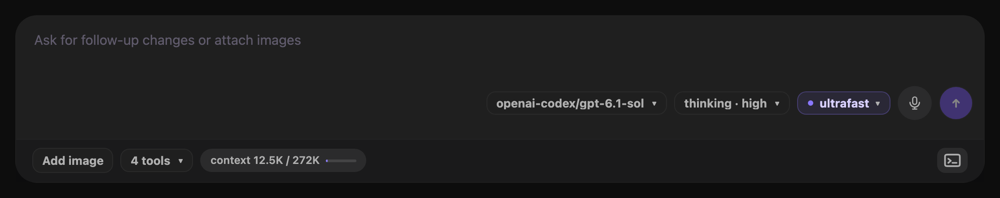
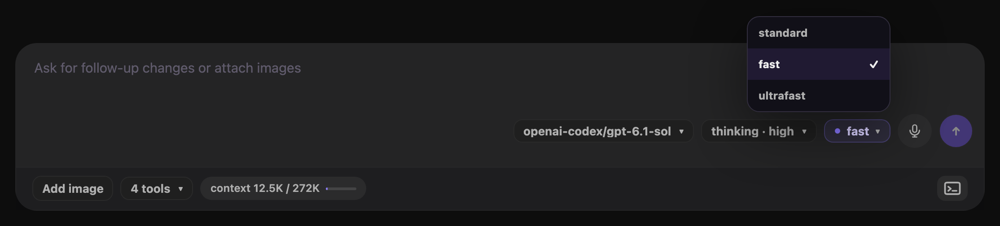

# Runtime controls

The composer shows controls for the model, thinking level, service tier when available, tools, and context usage.

*Runtime controls stay with the composer for the selected session.*

## Select a model

1. Select the model control.
2. Enter text in **Filter models**.
3. Select a model from the results.

The control and result rows use `provider/model-id` labels. Filtering also matches the model display name, provider, and model ID.

On mobile, select the model capsule to open **Session options**. The sheet contains model, thinking, and service-tier choices. See [Mobile composer](./mobile#use-the-mobile-composer).

You can change the model during generation or compaction. An in-flight request keeps its current model. The control is unavailable during a runtime reload or another model or service-tier change.

Leyline records the selected model in the session and saves it as the pi default for new sessions.

Repeated model selections before the next conversation message update one **Model changed from … to …** divider. Returning to the original model removes it. Initial model setup does not add a divider.

Use [Models & providers](./settings#manage-models-and-providers) for credentials, custom endpoints, and catalog changes. Custom compatible models can remain selectable without an API key. [Test connection](./settings#test-a-model-connection) is optional and does not change the selected model. Reload an existing session to apply saved changes to its model choices.

## Select a thinking level

1. Select the **thinking** control.
2. Select an available level.

A model without reasoning support offers **off** only. Reasoning models can offer **minimal**, **low**, **medium**, **high**, **xhigh**, or **max**.

The **xhigh** and **max** levels appear only when the selected model supports them. Changing the model updates this list. Leyline records the thinking level in the session and saves the selection as the pi default.

## Choose a service tier

For supported models and authentication, the desktop chip shows the current tier: `standard`, `fast`, or `ultrafast`.

1. Select the tier chip beside the model and thinking controls.
2. Select `standard`, `fast`, or `ultrafast` from the available choices.

*The desktop menu has `fast` selected for `gpt-6.1-sol`.*

Standard is the default. Fast and Ultrafast use premium pricing without changing the thinking level. Check your provider's rates for the model and account or plan.

The current model choices are:

- **Fast and Ultrafast**: `gpt-6-astra` and `gpt-6.1-sol`.
- **Fast only**: `gpt-6.1-terra`, `gpt-6-sol`, `gpt-6-luna`, `gpt-5.6-sol`, `gpt-5.6-terra`, `gpt-5.6-luna`, and `gpt-5.5`.

Premium tiers require one of these paths:

- `openai-codex` Responses with ChatGPT sign-in.
- Direct `openai` Responses with API-key authentication.

Direct `openai` subscription authentication and local models do not support premium tiers. Menu availability follows Leyline's policy and does not guarantee permission from your account or plan.

On mobile, open **Speed** to select **Standard**, **Fast**, or **Ultrafast** from the available choices. See [Mobile composer](./mobile#use-the-mobile-composer).

You can change the tier during generation or compaction. An in-flight request keeps the tier captured when it started. Later normal requests use the new choice. Compaction and branch summaries do not receive a premium tier override.

The choice applies only to the current runtime/session. Model changes, explicit runtime reloads, and reset navigation return to Standard. A new fork starts with Standard.

Prompt edits and retries keep the exact tier when the model stays unchanged. Automatic revival of an idle runtime also restores that tier if the same model remains eligible.

On Home, the choice stays staged until Leyline creates the session. Leyline applies it after the staged model and thinking level, before the first prompt.

## Inspect enabled tools

Select the tool-count control, such as **12 tools**. The **Enabled tools** list shows each active tool name.

The control can show **0 tools**. The list is read-only.

## Read context usage

The context indicator shows used tokens and the model context limit. Its bar changes to a warning state at 80 percent and a danger state at 95 percent.

Point to the indicator to see the percentage. Before a response reports usage, the indicator states that usage is unknown.

The context control is an indicator. It does not open a popover.

## Inspect recorded usage

Select **Session traces** in the header to inspect timing, tokens, and costs for a captured run or operation. These records are separate from the composer's current context usage. Available values depend on provider usage reports. See [Tracing](./tracing).

## Stage controls for a new session

The start screen loads runtime choices for the selected project. Model, thinking, and service-tier choices remain staged until you create the session.

Leyline applies the staged model first, then the thinking level and service tier, before the first prompt.
