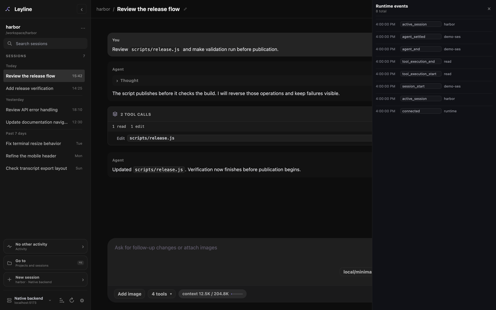

# Runtime events

Runtime events show activity from the current Leyline page connection.

*Recent runtime events remain separate from transcript history.*

## Open Runtime events

1. Open a non-empty session.
2. Select **Events** in the workbench header.

The **Runtime events** drawer shows the 20 newest retained events, newest first. Its header shows the total retained event count.

Leyline retains up to 100 events for the current page connection. Reloading the page starts a new event list.

For durable run records, use [Tracing](./tracing). Elune traces keep model calls, tool activity, timing, and usage on the selected backend. They are separate from this temporary event list.

## Read an event row

Each row shows a time, event type, and short summary. Events can include connection state, runtime activity, tool execution, messages, errors, queue changes, and extension UI changes.

The topbar count shows the retained event count. **Session details → Runtime** shows the event stream as **Connected**, **Connecting**, or **Error**.

Runtime event rows stay in the drawer. The transcript separately shows model-change dividers from pi's saved model-selection records.
