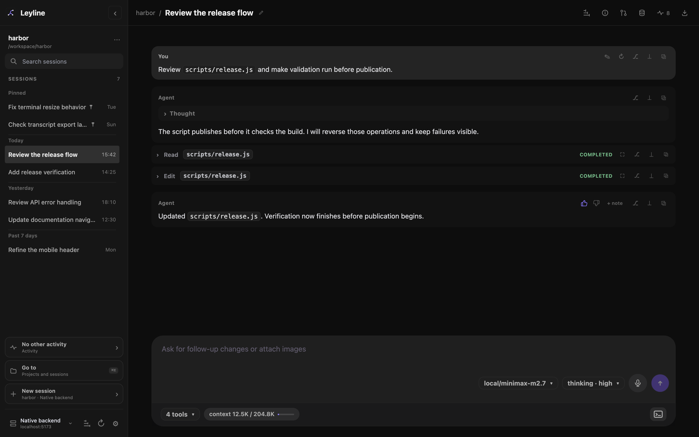
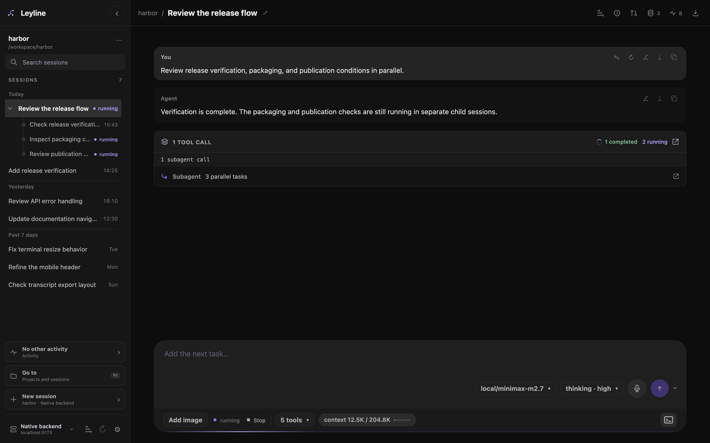

# Sessions

A session contains one pi conversation tree. Leyline shows the active branch as a transcript.

## Select a session

1. Find the session in the current project list.
2. Select the session name.

Use **Go to** when the session belongs to a different project.

You can also focus a session row and press **Enter** or **Space**. Press **Arrow Up** or **Arrow Down** to move between visible parent and child rows.

A selected session uses the route `/sessions/<encoded-id>`. The start screen uses `/`.

Command-click a session target to open it in a new tab or window. Use Ctrl-click
on other platforms or middle-click with a mouse. This behavior also applies to
**Open** and **Selected** controls in **Project settings → Sessions**.

## Browse the session list

The sidebar shows all regular sessions in the current project. It orders them from most recent modification to oldest.

The **Sessions** heading shows the session count. The list scrolls when it is longer than the available space.

Enter a session name or ID in **Search sessions** to filter the current project.

A flask after the title identifies a [deep research session](./deep-research). The marker remains visible after the run finishes.

## Pin a session

*Pinned sessions stay at the top of the current project list.*

1. Point to the session row, or move keyboard focus to the row.
2. Select **Pin session**.

Leyline moves the session to the **Pinned** group at the top of the current project list. Pinned sessions remain in modification-time order. Select **Unpin session** to return a session to its time group.

Leyline saves pins by backend connection in this Leyline installation. Pinning does not change the session file. A fork begins unpinned.

During sidebar search, Leyline uses search order and does not show the **Pinned** group. The pin marker remains beside the session title. **Go to** does not use pin state.

## Read runtime status

A session row can show these states:

- **running**: the agent is producing a response.
- **compacting**: pi is compacting the session context.
- **unread**: a background run finished or reported an error.
- **confirm**: the session waits for a reply to an extension confirmation.
- **N queued**: tasks or accepted inputs are waiting.
- **N held**: the queue is held until you select **Resume**.
- **error**: the background runtime reported an error.
- **plan**, **gather**, **synthesize**, or **report**: a research run is in that phase.
- **gather N/N**: that many research threads have finished.
- **ready**: the selected research session has a completed report.

Select **Activity** to supervise other live sessions, including sessions in the current project. It shows current work and provides **Open** and session-scoped **Stop** actions.

Background sessions continue when you open another session. Activity warns when multiple sessions share one CWD and have active work or queues that are not held.

Pending **Up next** tasks stay with their session when you switch sessions or refresh the browser. **Reload runtime** keeps those tasks held until you select **Resume**. A backend restart clears pending tasks. See [Composer](./composer#queue-the-next-task) for queue controls.

## Create a session in a project

Select **New session** at the bottom of the sidebar. You can also select **New session** in **Project settings → Sessions**.

Leyline creates an empty normal session in the current project CWD. Use the centered composer to send its first prompt.

Command-click, Ctrl-click, or middle-click **New session** to create one empty
session in a new tab or window. The current window does not change.

To create a research session, return to the start screen and select **research** before you send the prompt.

## Rename a session from the sidebar

1. Point to the session row.
2. Select **Rename session**.
3. Enter the new name.
4. Press **Enter**.

You can also double-click the session name. Press **Escape** to cancel the rename.

To rename the selected session, select its name in the workbench header.

## Inspect recorded runs

Select **Session traces** in the workbench header. Use **Session run** to select a captured run, then inspect its observations. Capture starts on for new runs. Older session logs are not backfilled. See [Tracing](./tracing).

## Delete a session

**Delete** moves the session JSONL file to Leyline trash. The session then disappears from Leyline.

1. Point to the session row.
2. Select **Delete session**.
3. Review the **Delete session?** dialog.
4. Select **Delete**.

You can also start deletion from **Project settings → Sessions**. Leyline does not provide a trash restore control in the interface.

Session deletion does not delete its Elune traces. Trace data can retain prompts and tool results after the session leaves the sidebar. See [Trace privacy](./tracing#keep-trace-data-private).

## Open a subagent session

Subagent child sessions appear as nested rows under their parent session in the sidebar. Select a child row to open its transcript directly. Use the chevron to the left of the parent title to show or hide its children.

By default, children expand when a child is live or selected. A manual chevron choice overrides this default. Settled children remain available under the parent, but collapse by default when none is live or selected. Children stay in creation order, so live updates do not reorder them.

**Search sessions** also matches child task labels, agent names, and IDs. See [Projects and search](./projects-and-search#find-a-session-in-the-current-project) for search behavior.

Children do not add to regular session counts and have no separate pins or **Activity** entries. To delete a child, point to its row and select **Delete subagent session**. Confirm deletion in the dialog. This moves the child's JSONL file to Leyline trash.

You can also open the [subagent inspector](./subagents#read-a-subagent-card), select a task, then select **Open child session**. An available **Child sessions** link in a trace observation also opens the child transcript.

The child-session header shows **← parent session**. Select it to return to the
parent session. Use a modified click on either session target to open it in a
new tab or window.
