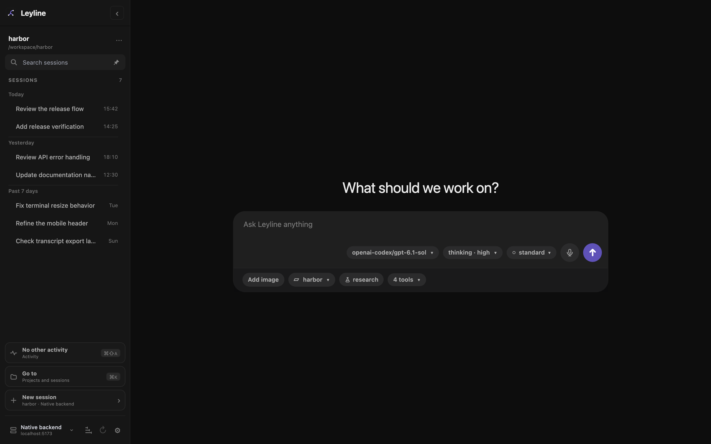

# Start screen

The start screen appears when no session is selected. One submission can create a session and send its first prompt.

*The start screen stages the project, session kind, and runtime choices before session creation.*

## Select a project

1. Select the project name below the composer.
2. Enter text in **Search projects** to filter the project list.
3. Select a project.

The project control shows **Choose project** when no project is selected.

Command-click, Ctrl-click, or middle-click a project choice to open the start
screen for that project in a new tab or window. The current window does not
change.

To use a different folder, select **Add new project**. The **Add project** browser opens.

## Add a project folder

1. Enter an absolute path, `~/` path, or relative path.
2. Use **Arrow Up** or **Arrow Down** to move the highlight.
3. Press **Enter** to open the highlighted folder.
4. Press **Command+Enter** or **Ctrl+Enter** to add the typed path.

Select **Home** to return to your home folder. Press **Escape** or select **Cancel** to close the browser.

If the typed folder does not exist, the action changes to **Create & add**. Leyline creates that folder when you confirm the action.

## Select the model and thinking level

1. Select the model control.
2. Enter text in **Filter models** if the list is long.
3. Select a model.
4. Select the thinking control.
5. Select an available thinking level.

These choices are staged for the new session. A model change can also change the available thinking levels.

On desktop, supported models show a lowercase tier chip beside these controls. Open it to choose `standard`, `fast`, or `ultrafast` from the available tiers. Standard is the default. Fast and Ultrafast use premium pricing.

Your choice stays staged for the new session. A model change resets it to Standard. See [Choose a service tier](./runtime-controls#choose-a-service-tier) for model, authentication, and account limits.

## Inspect enabled tools

Select the tool-count control, such as **12 tools**. The **Enabled tools** list shows the tools for the staged runtime.

The list is read-only. It can show **0 tools** when no tools are enabled.

## Start deep research

Select **research** below the composer before you send the first prompt. The heading changes to **What should we investigate?**

Leyline creates a research session and starts its planning phase. The control appears only when the selected backend supports deep research.

Shell mode always creates a normal session. See [Deep research](./deep-research) for phases, source evidence, citations, and reports.

## Check trace capture before a run

Select the **Trace explorer** icon button at the bottom of the sidebar. The explorer opens without a selected session and lists recorded runs on the selected backend.

Capture starts on for new runs. Expand **Capture new runs** in the trace footer to change it before submitting private data. Traces can retain prompts and tool results. See [Tracing](./tracing).

## Send the first prompt

1. Select a project.
2. Enter the first task in **Ask Leyline anything**.
3. Press **Enter** or select the send button.

Leyline creates the session first. It then applies the staged model, thinking level, and service tier before the prompt.

Press **Shift+Enter** to add a line break.

## Paste images

Paste one or more images into the composer. Leyline adds each image to the attachment tray.

Select **×** on an attachment to remove it. Leyline sends images directly when the staged model supports image input.

For other models, Leyline uses the configured project or global vision model. When the prompt runs, the model calls `vision_agent` to inspect the images. The tool call and result appear in the transcript. If no vision model is configured, the warning blocks submission.

Open **Settings → Agent defaults** to select a global **Vision model**. Use **Project actions → Project settings → Settings** for project overrides. Session overrides require an existing session.

Leyline accepts PNG, JPEG, GIF, and WebP image data. The current composer has no fixed count or byte limit.

## Use dictation

Select the composer microphone button to record speech. Select **Finish** to add recognized text to the draft, or **Cancel** to discard the recording. Sending a draft finishes dictation first and then uses the normal send or queue behavior.

See [Dictation](./dictation) for method choices, local model setup, and shortcut details.

## Select a slash command

1. Enter `/` followed by part of a command name.
2. Use **Arrow Up** or **Arrow Down** to select a result.
3. Press **Tab** or **Enter** to insert the command.

The list identifies each item as **Command**, **Prompt**, or **Skill**. Press **Escape** to close the list.

## Run a shell command

Start the draft with `!` or `!!`.

- `! command` runs the command and includes its output in session context.
- `!! command` runs the command and excludes its output from session context.

The composer shows **shell · context** or **shell · hidden**. Shell commands cannot include image attachments.
