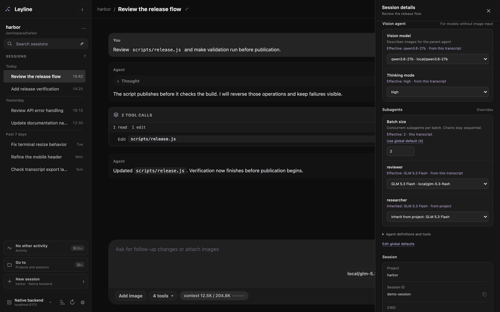

# Manage subagents

Subagents run delegated tasks in child sessions with separate context. Open [child transcripts from the sidebar](./sessions#open-a-subagent-session), or inspect live activity and task results from an Activity card.

*Batch size sets concurrent work per batch. Each agent row shows the model and its source.*

## Open subagent settings

1. Select **Open settings** at the bottom of the sidebar.
2. Select **Agent defaults**.
3. Find **Subagents**.

The list includes project and global agent definitions. Expand **Agent definitions and tools** for descriptions, source paths, model and thinking defaults, and tool lists.

Deep research uses a reserved bundled `researcher`. It does not appear in this list and inherits the parent model and thinking level by default.

## Select a model scope

The surface determines the scope:

- **Settings → Agent defaults** supplies global defaults for projects on the selected backend.
- **Project actions → Project settings → Settings** changes defaults for that project.
- **Session details** in the workbench header changes only the selected session. Forks copy this override.

Select a model in the subagent row. The option label contains the model name and `provider/model-id`.

Select the inherited option to remove a project or session override. In **Agent defaults**, select **Use agent definition** to remove the global override.

Select **Parent session model** to store `inherit`. The child uses the parent session model when that override applies.

The **Effective** or **Inherited** text shows the result from the displayed scope and its broader defaults. A global view does not include project or session overrides.

## Understand model precedence

Leyline selects a child model in this order:

1. A model requested for the specific subagent tool call.
2. The session override.
3. The **Project** override.
4. The **Global** override.
5. The model in the agent definition.
6. The child runtime default.

An applicable `inherit` value uses the parent session model.

## Understand thinking precedence

Subagent settings manage model overrides and batch size. Thinking comes from the subagent request or agent definition.

A thinking level requested for one child run takes priority. Otherwise, the agent definition applies. The child runtime default applies when neither value exists.

The `inherit` thinking value uses the parent session thinking level.

## Understand execution modes

The agent can use three subagent modes:

- **single** runs one agent for one task.
- **parallel** runs tasks concurrently in batches of the configured size.
- **chain** runs steps in order and replaces `{previous}` with the prior output.

A model or thinking value on one task takes priority over the mode-level value.

Multiple top-level **single** calls in one assistant message form one implicit group. Calls run in message order, in waves. Each wave waits for all calls in the preceding wave to finish. Each call keeps its tool-call ID, progress, and result.

Singles still form a group when the message also contains **parallel** or **chain** calls. Each explicit parallel call has a separate batch schedule. Chains stay sequential. Nested tool calls do not enter the implicit group.

## Configure batch size

**Batch size** sets the maximum concurrent subagents per batch. The default is 4. It does not limit total concurrent work across a session or backend.

To change the global default:

1. Open **Settings → Agent defaults**.
2. Find **Subagents**.
3. Enter a positive whole number in **Batch size**.
4. Leave the field to save the value.

The value must be a positive safe integer. The global default applies to projects on the selected backend, not every saved backend.

For a session override, open **Session details** in the workbench header. Under **Subagents**, change **Batch size**. Select **Use global default** to remove the override. Forks copy the session override. There is no project batch-size override.

*This session uses 2 subagents per batch. The global default stays at 4.*

Each implicit group or explicit parallel call reads its effective size once. Changes apply to future groups and calls without a runtime reload. Running groups keep their size.

See [Mobile batch settings](./mobile#set-a-session-batch-size) for the mobile controls.

## Session titles

The parent agent must supply a short, nonblank title for every child session. This includes each parallel task and chain step. If any title is missing or blank, the call stops before any children start.

Leyline saves the title as the child's session name. The sidebar shows the current session name. The inspector and HTML export show the supplied title, with full instructions under **Full task prompt**.

Older sessions without titles keep their existing label fallbacks.

## Read a subagent card

Each subagent call stays in one compact row inside an Activity card. Task details open in the subagent inspector instead of expanding the transcript.

If the card contains only one subagent call, select its header or row to open the inspector directly. This also applies to a call with several parallel tasks. If the card contains several tool calls, expand it first, then select the subagent row.

*The Activity card keeps its outcome counts while the inspector shows one task at a time.*

The inspector opens as a side sheet on desktop and a bottom sheet on mobile:

1. Select a task to see its action ledger and status.
2. Select a ledger row to read the full entry. **Read full** opens the latest response.
3. Select **Full task prompt** to read the original instructions.
4. Select **Open child session** for the complete child transcript, when available.

The small header label shows the agent, for example **Subagent · general**. The meta row shows Model, Thinking, and task status as chips, with research source counts when present. **Full task prompt** appears beside the Copy and Close controls. The inset card shows the latest response or thought. Select **Read full** to open its complete text.

Model and Thinking chips prefer the child's current model and thinking level while the run is active. When the run finishes, they show the recorded result, then fall back to the values requested in the tool call. The Model chip can include a source label such as **session override**, shown only when its origin is known. A queued call that requests the parent session model shows the placeholder `inherit` until the child starts. Older sessions can omit these chips because their records lack the fields.

The **Activity** heading shows entry and tool-call counts. The connection state, for example **Live updates** or **Saved activity**, appears beside these counts. Each flat row has an icon, action, target or excerpt, outcome, and character count. Thoughts, messages, and tool calls have separate rows.

The entry reader uses the same sheet. Messages have **Formatted** and **Source** views. Tool calls have **Output** and **Arguments** views. Arguments are unavailable when the original call was not recorded. **Copy full text** copies the entry text or the selected arguments. **Back to activity** restores your place in the ledger.

The preview keeps the latest 80 assistant messages and tool results. A message with both thought and text can produce more than one row. Each available entry retains its full text; this limit applies to the history, not the size of an entry. Use **Open child session** to read older activity.

Use Command-click, Ctrl-click, or middle-click on **Open child session** to open the child in a new tab or window. Selecting a task only changes the inspector's selected task.

**Copy tool output** in the inspector header copies the parent tool response. Press Escape once to return from an open entry to the ledger. Returning from the prompt reader puts focus back on the header **Full task prompt** button. Press Escape again, select the close button, or select the backdrop to close the inspector. Closing it does not stop the child run.

The task list stays in its original order. Live updates and saved results preserve the selected task and reading position.

On a task change, the current reader stays visible until the next preview is ready. The reader, task highlight, and footer then change together. The sheet stays in place. Reduced motion removes the animation.

**Stopped** means cancellation. **Failed** means a task error. **Not started** means the task did not run. Missing final outcomes show **Unknown**. Completed results remain available when another task stops or fails. If task results are unavailable, **Call output** preserves the original tool response or error.

Resolve pending extension confirmations before opening the inspector. A new confirmation closes it so the **Confirm** and **Cancel** controls remain accessible.

## Follow an active child

Select a running task in the inspector to follow its child session. The ledger shows recent assistant messages and tool calls. Select a running call to read its full current output.

New rows move into place, and status changes fade within their rows. During large bursts, only a few rows animate at once. Other rows update immediately. Text updates do not restart the row animation. Reduced motion removes these effects.

Scroll up to pause following. Select **New output** or **Jump to latest** to return to the latest activity. The selected task and open entry remain in place during saved-entry updates and reconnects.

Recently viewed tasks can reopen from a temporary preview cache. If a saved-history refresh fails, live text and tool output can continue. Select **Retry** to request saved history again.

Reading the preview keeps the parent session selected. Closing the inspector clears its temporary previews and releases the connection without stopping the child run. If the connection drops, the preview keeps its last received activity until updates resume.

Use **Open child session** for the full transcript. [HTML exports](./export#inspect-exported-subagents) include only task messages saved with the parent call. They do not fetch the child's full history or show live updates.

## Inspect delegated runs

Open **Session traces** in the parent header to inspect the subagent tool observation. Available **Child sessions** links open child transcripts. Captured child runs also appear in the selected backend's trace explorer.

Trace capture starts on for new runs and can retain delegated prompts and results. See [Tracing](./tracing) for capture controls and privacy.

## Return to the parent session

Child sessions also open from [nested sidebar rows](./sessions#open-a-subagent-session). Their header shows **← parent session**.

Select **← parent session** to return to the parent transcript. Use a modified
click to open the parent in a new tab or window.
