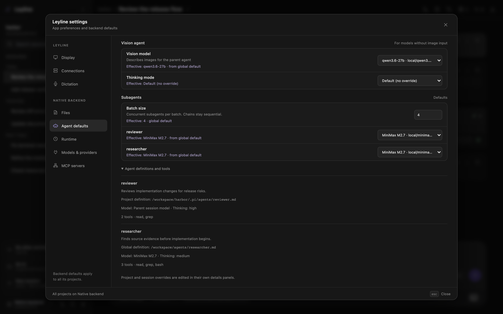
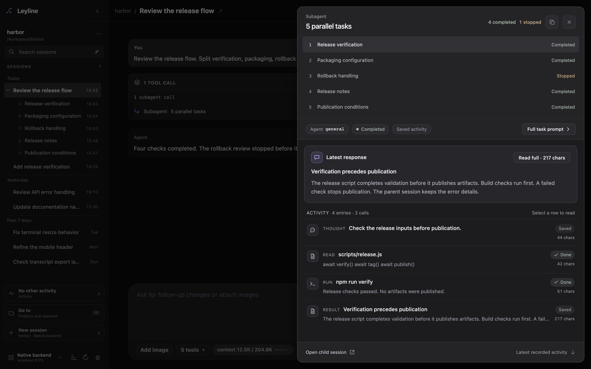
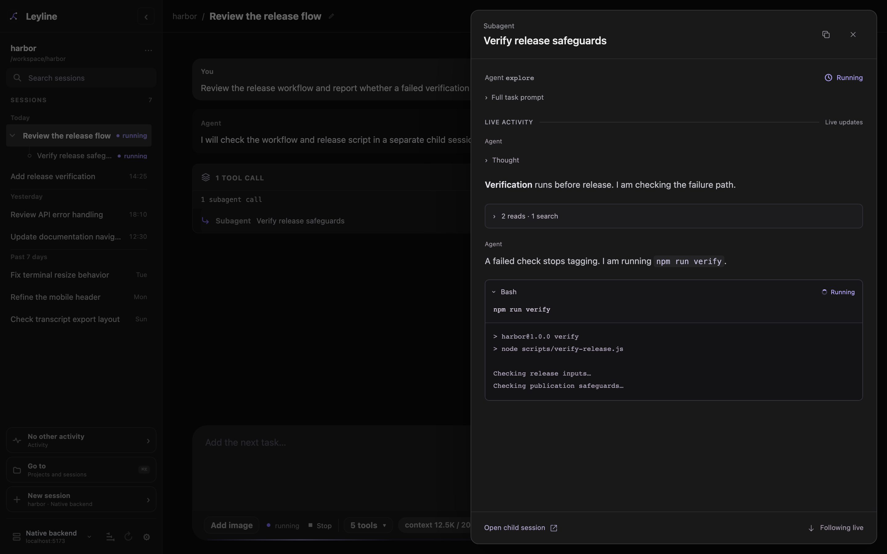

# Manage subagents

Subagents run delegated tasks in child sessions with separate context. Open [child transcripts from the sidebar](./sessions#open-a-subagent-session), or inspect live activity and task results from an Activity card.

*Each subagent row shows the model and its source at the scope you are editing.*

## Open subagent settings

1. Select **Open settings** at the bottom of the sidebar.
2. Select **Agent defaults**.
3. Find **Subagents**.

The list includes project and global agent definitions. Expand **Agent definitions and tools** for descriptions, source paths, model and thinking defaults, and tool lists.

Deep research uses a reserved bundled `researcher`. It does not appear in this list and inherits the parent model and thinking level by default.

## Select a model scope

The surface determines the scope:

- **Settings → Agent defaults** supplies global defaults for projects on the selected backend.
- **Project actions → Project settings → Settings** changes defaults for that project.
- **Session details** in the workbench header changes only the selected session. Forks copy this override.

Select a model in the subagent row. The option label contains the model name and `provider/model-id`.

Select the inherited option to remove a project or session override. In **Agent defaults**, select **Use agent definition** to remove the global override.

Select **Parent session model** to store `inherit`. The child uses the parent session model when that override applies.

The **Effective** or **Inherited** text shows the result from the displayed scope and its broader defaults. A global view does not include project or session overrides.

## Understand model precedence

Leyline selects a child model in this order:

1. A model requested for the specific subagent tool call.
2. The session override.
3. The **Project** override.
4. The **Global** override.
5. The model in the agent definition.
6. The child runtime default.

An applicable `inherit` value uses the parent session model.

## Understand thinking precedence

Subagent settings manage model overrides only. Thinking comes from the subagent request or agent definition.

A thinking level requested for one child run takes priority. Otherwise, the agent definition applies. The child runtime default applies when neither value exists.

The `inherit` thinking value uses the parent session thinking level.

## Understand execution modes

The agent can use three subagent modes:

- **single** runs one agent for one task.
- **parallel** runs task groups concurrently, with up to four tasks in each batch.
- **chain** runs steps in order and replaces `{previous}` with the prior output.

A model or thinking value on one task takes priority over the mode-level value.

## Session titles

The parent agent must supply a short, nonblank title for every child session. This includes each parallel task and chain step. If any title is missing or blank, the call stops before any children start.

Leyline saves the title as the child's session name. The sidebar shows the current session name. The inspector and HTML export show the supplied title, with full instructions under **Full task prompt**.

Older sessions without titles keep their existing label fallbacks.

## Read a subagent card

Each subagent call stays in one compact row inside an Activity card. Task details open in the subagent inspector instead of expanding the transcript.

If the card contains only one subagent call, select its header or row to open the inspector directly. This also applies to a call with several parallel tasks. If the card contains several tool calls, expand it first, then select the subagent row.

*The Activity card keeps its outcome counts while the inspector shows one task at a time.*

The inspector opens as a side sheet on desktop and a bottom sheet on mobile:

1. Select a task to read its status, live activity, or result.
2. Expand **Full task prompt** to read the original instructions.
3. Select **Open child session** to open the child transcript, when available.

Use Command-click, Ctrl-click, or middle-click on **Open child session** to open the child in a new tab or window. Selecting a task row only changes the inspector's selected task.

**Copy result** copies the selected task's text result. **Copy tool output** in the inspector header copies the parent tool output. Press Escape, select the close button, or select the backdrop to close the inspector. Closing it does not stop the child run.

The task list stays in its original order. Live updates and saved results preserve the selected task and reading position.

**Stopped** means cancellation. **Failed** means a task error. **Not started** means the task did not run. Missing final outcomes show **Unknown**. Completed results remain available when another task stops or fails. If task results are unavailable, **Call output** preserves the original tool response or error.

Resolve pending extension confirmations before opening the inspector. A new confirmation closes it so the **Confirm** and **Cancel** controls remain accessible.

## Follow an active child

Select a running task in the inspector to follow its child session. The preview shows recent assistant messages and live tool output.

Thoughts and completed tools start collapsed. Expand a row to inspect it. Active tools show their current output, with up to 14 recent lines for long results.

Scroll up to pause following. Select **New output** or **Jump to latest** to return to the latest activity. The selected task and expanded content remain in place during saved-entry updates and reconnects.

Reading the preview keeps the parent session selected. Closing the inspector releases the preview connection without stopping the child run. If the connection drops, the preview keeps its last received activity until updates resume.

Use **Open child session** for the full transcript and tool image results. Live child previews are available in Leyline, not in HTML exports.

## Inspect delegated runs

Open **Session traces** in the parent header to inspect the subagent tool observation. Available **Child sessions** links open child transcripts. Captured child runs also appear in the selected backend's trace explorer.

Trace capture starts on for new runs and can retain delegated prompts and results. See [Tracing](./tracing) for capture controls and privacy.

## Return to the parent session

Child sessions also open from [nested sidebar rows](./sessions#open-a-subagent-session). Their header shows **← parent session**.

Select **← parent session** to return to the parent transcript. Use a modified
click to open the parent in a new tab or window.
